 

I'm an **LLM Evaluation Engineer at Invisible Technologies**. I score voice agents on a frontier-lab program: did the agent finish the task, follow instructions, take turns cleanly, handle interruptions, answer fast and stay safe? When it slips, I work out whether the speech layer or the reasoning layer dropped it.

Before this I spent two years building and reviewing LLM evaluation tasks. I wrote the scoring guide a 30-person team worked from, then led that team through a ~800-task model comparison.

**AI Access Desk Employee** earned an Honourable Mention at the Supervity AutoPilot Hackathon in Ahmedabad. My team built it in 48 hours: it reads IT-access requests from email, checks each one against a role-based policy, and settles it or routes it to the right approver with the reason.

I work mostly in Python and React. Earlier I was a frontend intern at Labridge; my older React projects live in the Repositories tab.

  &nbsp;&nbsp;
  &nbsp;&nbsp;
  

